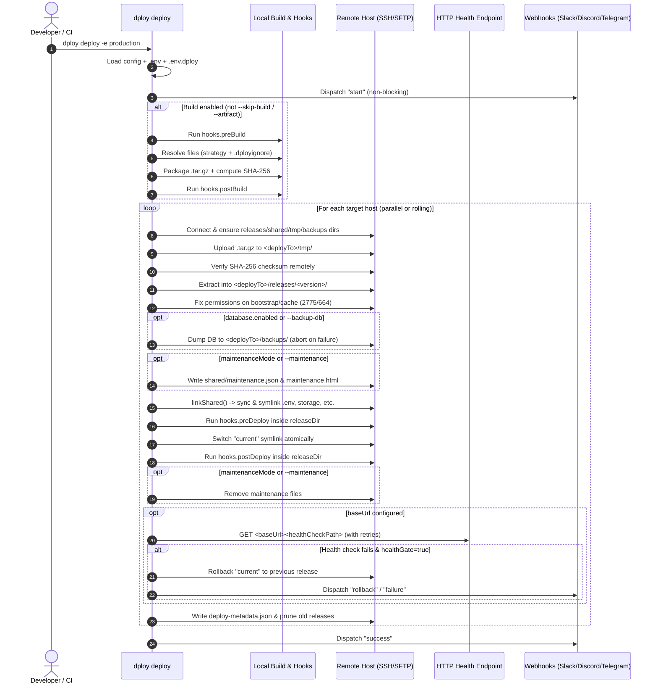

# Deployment Lifecycle & Data Flow

This document traces what happens internally when `dploy deploy` runs (`src/commands/deploy.ts`).

---

## End-to-End Sequence

---

## Step-by-Step Breakdown

1. **Configuration & Version Resolution (`src/core/config.ts`, `src/core/utils.ts`)**:
   - Loads `deploy.config.yml` / `.yaml` / `.json`, resolves `extends` inheritance, and interpolates `${VAR:-default}` from `.env` and `.env.dploy`.
   - Resolves release version in priority order: `--version-override` / `-V` → `versionCommand` → `versionFile` → `VERSION` → `composer.json` → `package.json` → timestamp fallback.
2. **Artifact Resolution (`src/features/deploy-artifact.ts`, `src/features/packager.ts`)**:
   - Uses `--artifact <path>` (custom archive), `--skip-build` (latest matching `release-*.tar.gz`), or builds a new archive using `build.strategy` (`copy`, `include`, `exclude`, `hybrid`) while honoring `.dployignore`.
3. **Upload & Checksum Gate (`src/core/ssh.ts`, `src/features/checksum.ts`)**:
   - Uploads archive to `<deployTo>/tmp/` with live byte progress (`src/core/progress.ts`) and verifies SHA-256 remotely before extracting.
4. **Release Extraction & Framework Permission Healing (`src/commands/deploy.ts`, `src/features/shared.ts`)**:
   - Extracts archive into `<deployTo>/releases/<version>/`.
   - If `bootstrap/cache` exists, applies `2775` (directories) and `664` (files) so PHP-FPM (`www-data`) and the deploy user can both write compiled manifests.
   - `linkShared()` initializes or syncs shared paths into `<deployTo>/shared/`, scaffolds standard subdirectories for `storage` (Laravel) and `writable` (CodeIgniter 4), applies `2775`/`664` permissions on `storage` and `writable`, removes the release's local copy, and creates the symlink.
5. **Atomic Cutover & Health Gate (`src/core/ssh.ts`, `src/commands/health.ts`)**:
   - Captures the previous `current` target before switching.
   - Switches `<deployTo>/current` atomically.
   - If `baseUrl` is configured, polls `<baseUrl><healthCheckPath>` with retries. When `healthGate` and `autoRollback` are enabled, a failed probe automatically restores `current` to the previous release.
6. **Metadata & Cleanup (`src/features/release-metadata.ts`, `src/features/cleaner.ts`)**:
   - Writes `deploy-metadata.json` (version, environment, timestamp, git SHA/branch/commit message, deployer).
   - Prunes old releases beyond `keepVersions`.
