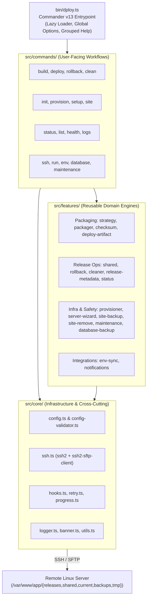

# Architecture Overview

`dploy-cli` is a modular TypeScript ESM CLI application (`"type": "module"` in `package.json`) compiled with `tsc` into `dist/`.

---

## System Architecture

---

## Directory & Module Responsibilities

| Layer | Directory | Responsibility |
| :--- | :--- | :--- |
| **CLI Entrypoint** | `bin/dploy.ts` | Registers all Commander commands, global options, composable option helpers (`withDryRun`, `withJson`, `withAdminAuth`), grouped `--help`, `preAction` logging/banner setup, and dynamic `lazyAction` imports. |
| **Commands** | `src/commands/` | Orchestrates each CLI command (`deploy`, `setup`, `site`, `database`, `env`, `logs`, etc.), handles user prompts (`inquirer`), dry-run previews, and cluster fan-out. |
| **Features** | `src/features/` | Self-contained domain logic (packaging strategies, SHA-256 verification, shared symlink linking, Nginx/systemd template generation, DB dump execution, webhook dispatch). |
| **Core** | `src/core/` | Config loading/validation (`deploy.config.yml`/`.json`), `.env` + `.env.dploy` interpolation, SSH/SFTP connection pooling, retry logic, secret-redacting logger, and shell-escaping utilities. |
| **Templates** | `templates/` | Starter `deploy.config.*` files (`node`, `laravel`, `ci4`, `fastapi`, `go`, `spa`), `.env.dploy.example`, and `templates/services/` (Nginx & systemd templates). |
| **Tests** | `tests/` | Node native test runner (`node --test`) suites executed sequentially via `scripts/run-tests.js`. |

---

## Key Design Decisions

1. **Lazy-Loaded Command Modules (`bin/dploy.ts`)**:
   Command handlers are imported dynamically inside `.action()` via `lazyAction(...)`. Fast commands such as `dploy --help` or `dploy --app-version` do not parse `ssh2`, `inquirer`, `fast-glob`, or `tar`.
2. **Global Options via `optsWithGlobals()`**:
   Global flags (`-e, --env`, `-v, --verbose`, `-d, --debug`, `-q, --quiet`, `-y, --yes`, `--passphrase`) are declared once on `program` with `showGlobalOptions: true`, and read in `preAction` and command actions via `cmd.optsWithGlobals()`.
3. **Zero-Downtime Remote Layout**:
   Every environment deploys into `<deployTo>` containing:
   - `releases/<version>/` — immutable extracted release directories
   - `shared/` — persistent files/directories (`.env`, `storage/`, `writable/`) symlinked into every release
   - `current` — atomic symlink (`ln -sfn` + `mv -Tf`) pointing to the active release
   - `backups/` — automated/manual database snapshots
   - `tmp/` — temporary archive upload staging
4. **Privilege Separation (`username` vs `admin`)**:
   Everyday deployments run as an unprivileged deploy user (`env.username`, e.g., `deploy`). Elevated operations (`dploy setup`, `dploy site *`, `dploy db * -A`, `dploy run -A`, `dploy logs -A`) can switch to `env.admin` or `--admin-user` without granting blanket root access to routine deploys.
5. **Secret Redaction in Logger (`src/core/logger.ts`)**:
   `redactSecrets()` masks passwords, passphrases, `cfKey`, `MYSQL_PWD`, `PGPASSWORD`, `-p'...'`, and `--admin-password` across all log levels, while `--quiet` / `--json` suppresses non-error stdout.
